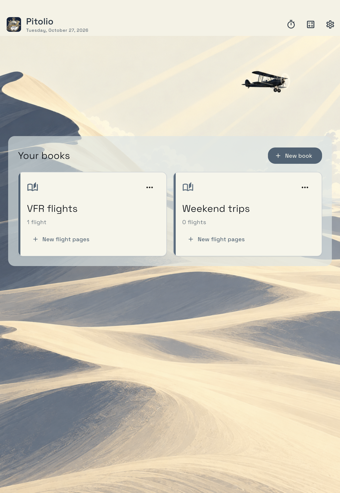
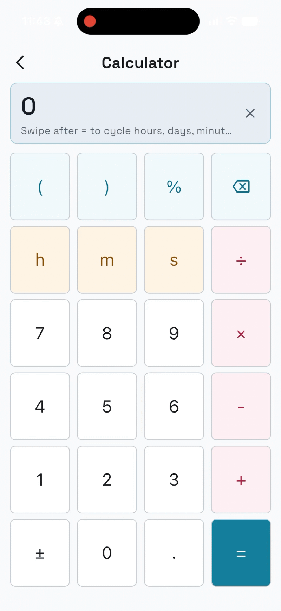

# Pitolio

Public support and privacy: **[couillonnade.github.io/pitolio-support](https://couillonnade.github.io/pitolio-support/)**. This repository contains the complete public user guide and website assets for **Pitolio 1.2.0**, reviewed on **27 October 2026**.

Books, flight pages and flight tracking with a fuel timer for general aviation. An **Air Pito** app.

On **iPad**, keep each flight's notes in a book, write with Apple Pencil, fill an ATIS with a guided keyboard, and keep the fuel timer in view. On **iPhone**, start flights, use the fuel timer, review Flight history and calculate durations.

[Watch the demos below](#demos) to see field entry, ATIS, multiple pages, time calculations and template editing.

The app is available in **French and English**. A French device starts in French; all other device languages start in English. Change this anytime in **Settings → Language** (**Réglages → Langue**). Saved notes and custom templates keep their original text.

| Feature | iPhone | iPad |
| --- | --- | --- |
| Fuel timer, reminders and optional Auto Track | Yes | Yes |
| Flight history and time calculator | Yes | Yes |
| Books, templates and PDF backgrounds | Unavailable | Yes |
| Pencil notes, field keyboards, guided ATIS and book export/backup | Unavailable | Yes |

Pitolio works without an account or internet connection. Notes and flight records are stored locally; you can export them, and device backups may include them.

## Demos

Enter information with the keyboard, Apple Pencil or the guided wizard. Choose whichever suits you at the time, switch whenever you want, and mix the methods within the same flight notes.

### Enter data with the keyboard

Tap a field and type its value using the keyboard.

### Copy ATIS with the wizard

Use the guided wizard to enter the ATIS information you hear, step by step.

### Enter data with Apple Pencil

Write directly in the fields with Apple Pencil, alongside any typed entries.

### Work with multiple pages and zoom levels

Move between flight pages and use different zoom levels to see the whole page or focus on a detail.

### Calculate times and durations

Use the time calculator to work with hours and minutes.

### Edit templates visually

Use the graphical template editor to arrange fields and adapt the layout to your own notes.

## Start here

- [Quick start](docs/quick-start.md) — create flight pages or start a flight.
- [Books and flight pages](docs/books-and-flights.md) — pages, navigation, rename and Trash.
- [Writing and field entry](docs/writing-and-fields.md) — Pencil, keyboards, ATIS and flight times.
- [Templates](docs/templates.md) — use Flight Notes, import a PDF, or make a form.
- [Flights and fuel timer](docs/fuel-timer.md) — fuel checks, milestones, Auto Track and history.
- [Export and backup](docs/export-and-backup.md) — readable PDFs or editable `.apbook` files.
- [Settings and calculator](docs/settings-and-calculator.md).
- [Troubleshooting](docs/troubleshooting.md) and [contact support](https://couillonnade.github.io/pitolio-support/#support).
- [Privacy policy](https://couillonnade.github.io/pitolio-support/privacy-policy.html) · [Confidentialité](https://couillonnade.github.io/pitolio-support/privacy-policy.fr.html).

The built-in **Flight Notes** form includes airport frequencies, departure/arrival ATIS, manual UTC Sunset, flight times and space for clearances and handwriting. Each flight starts with one or two pages and can grow to four. Copy a flight using per-field Copy content settings, design forms with sections and columns, and correct shared flight times in Zulu or Local. Flight pages also work without starting a flight.

This repository contains user help and support information. It does not contain the app's source code. Screenshots are genuine simulator captures refreshed for the current interface; [their provenance](assets/screenshots/README.md) is recorded separately.

For the maintainer: [live site and App Store URLs](PUBLISHING.md).

The support homepage and privacy policies are static HTML with a shared stylesheet. The user guide is Markdown, rendered by GitHub Pages. No local build or package installation is needed. See [PUBLISHING.md](PUBLISHING.md) for editing and publishing instructions.
