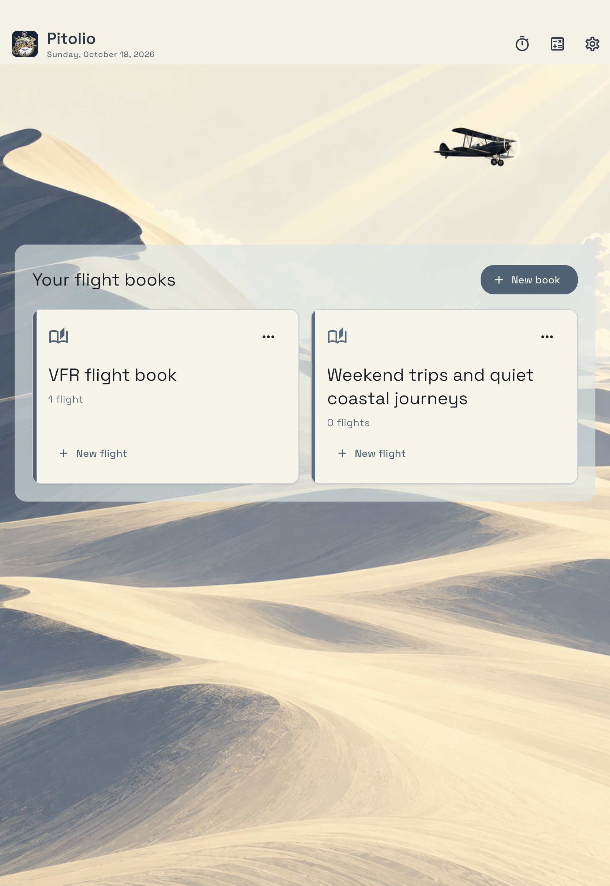

# Pitolio

Public support and privacy: **[couillonnade.github.io/pitolio-support](https://couillonnade.github.io/pitolio-support/)**. 

Flight books, handwritten cockpit notes and a Fuel Timer for general aviation. An **Air Pito** app.

On **iPad**, keep each flight's notes in a book, write with Apple Pencil, fill an ATIS with a guided keyboard, and keep the Fuel Timer in view. On **iPhone**, use the focused Fuel Timer, saved flight logs and time calculator.

The app is available in **French and English**. A French device starts in French; all other device languages start in English. Change this anytime in **Settings → Language** (**Réglages → Langue**). Saved notes and custom templates keep their original text.

| Feature | iPhone | iPad |
| --- | --- | --- |
| Fuel Timer, reminders and optional Auto Track | Yes | Yes |
| Saved timer flights and time calculator | Yes | Yes |
| Flight books, templates and PDF backgrounds | Unavailable | Yes |
| Pencil notes, field keyboards, guided ATIS and book export/backup | Unavailable | Yes |

Pitolio works without an account or internet connection. Notes and flight records are stored locally; you can export them, and device backups may include them.

## Start here

- [Quick start](docs/quick-start.md) — create a book or start the timer.
- [Books and flights](docs/books-and-flights.md) — pages, navigation, rename and Trash.
- [Writing and field entry](docs/writing-and-fields.md) — Pencil, keyboards, ATIS and flight times.
- [Templates](docs/templates.md) — use Flight Notes, import a PDF, or make a form.
- [Fuel Timer](docs/fuel-timer.md) — fuel checks, milestones, Auto Track and history.
- [Export and backup](docs/export-and-backup.md) — readable PDFs or editable `.apbook` files.
- [Settings and calculator](docs/settings-and-calculator.md).
- [Troubleshooting](docs/troubleshooting.md) and [contact support](SUPPORT.md).
- [Privacy policy](privacy-policy.md).

The built-in **Flight Notes** form includes airport frequencies, departure/arrival ATIS, manual UTC Sunset, flight times and space for clearances and handwriting. Each flight starts with one or two pages and can grow to four. Notes also work with the timer off.

This repository contains user help and support information. It does not contain the app's source code. Screenshots are genuine simulator captures; [their provenance](assets/screenshots/README.md) is recorded separately.
