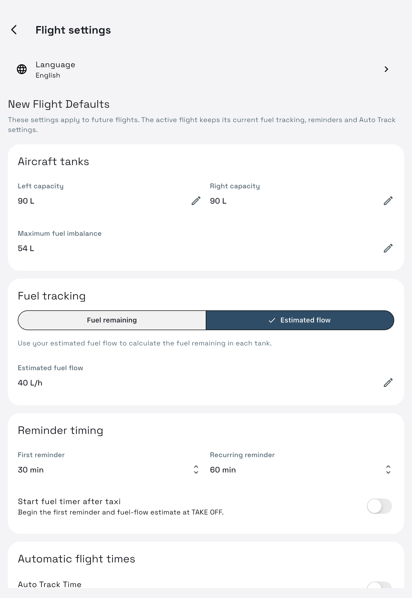
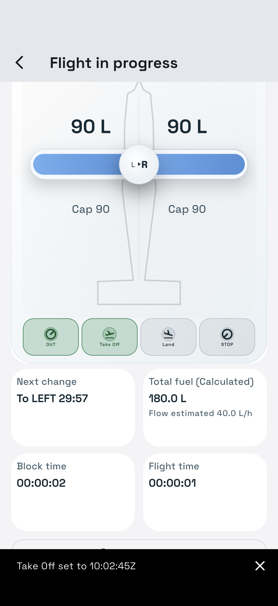
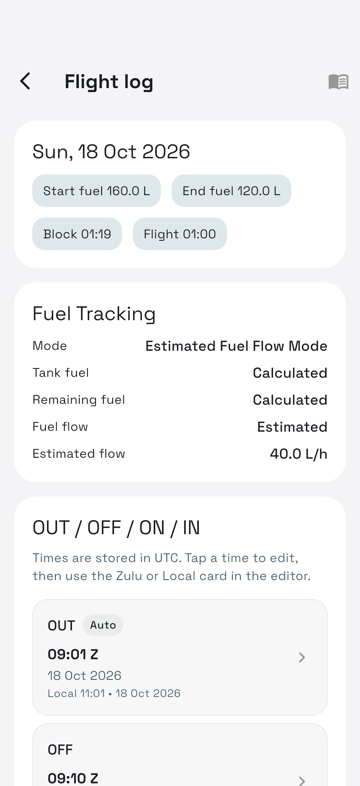

# Flights and the fuel timer

Pitolio 1.2.0 · Updated 27 October 2026

A **flight** records OUT/OFF/ON/IN and includes the **fuel timer**, which counts down to fuel checks and tank reminders. Only one flight can be active. Use **Start flight** on iPhone or iPad Home, or above the flight pages on iPad.

## Configure once, start quickly

In **Flight settings**, set left/right tank capacities, maximum imbalance, fuel tracking mode, reminder intervals, taxi behavior and Auto Track defaults. These are under **Settings → Flight settings** on iPad and **Settings** on iPhone.

Tap **Start flight**. Choose the first tank and starting left/right liters, then **Start flight**. Levels are prefilled from the last completed flight; check them before departure. Recording OUT is a separate departure action. Changing defaults affects future flights; the active flight keeps its configuration.

## The two fuel modes

| Mode | What you enter | What Pitolio calculates |
| --- | --- | --- |
| Fuel remaining | Actual total fuel remaining at a check | Fuel used and observed flow |
| Estimated flow | Estimated liters/hour | Estimated remaining left/right fuel |

Fuel values use liters. The aircraft view shows the active tank, tank levels and imbalance warning against the configured limit. Estimated values are calculations from your entries, not readings from an aircraft sensor.

## Record departure, takeoff, landing and arrival

| Event | Timestamp | Meaning |
| --- | --- | --- |
| Departure | OUT | Off-block; starts block time |
| Takeoff | OFF | Starts flight time |
| Landing | ON | Ends flight time |
| Arrival | IN | Ends block time |

The flight strip highlights the current step and enables the next. It also shows the fuel timer countdown and left/right liters. Its open action shows the full flight screen. **End & save flight** confirms final fuel and archives the flight log, including taxi-only or aborted flights. Entering IN stops timing; use **End & save flight** to archive an unsaved flight.

Before fuel timing starts, changing tanks only selects the first tank. It does not use fuel, create a fuel-log entry or schedule a reminder. With **Start fuel timer after taxi** off, OUT starts both estimated consumption and the first reminder interval. Waiting before OUT changes neither.

If **Start fuel timer after taxi** is configured, the first fuel reminder and estimated consumption begin at Takeoff. The configured taxi fuel is deducted from the active tank then. Otherwise fuel timing begins at OUT.

**Cancel flight** discards the active flight and its fuel log after confirmation. Associated flight pages, handwriting and recorded times remain. Starting another flight with the same pages asks you to clear the old time boxes. Choose **Clear and Fly** or **Cancel**.

## Fuel checks and tank changes

Tap the tank selector or respond to a reminder. In **Fuel remaining** mode, enter the requested fuel reading. In **Estimated flow** mode, review calculated quantities and choose the tank and next flow; it does not ask you to reconcile measured tank levels. Choose **switch** or **stay**, and optionally change the next reminder once. The fuel log records the entry.

The entry uses the time shown when its editor opens. Fuel consumption and Auto Track continue while you edit; saving later applies the entry at that displayed time. If the flight ends while fuel entry is open, Save asks **Flight ended. Save this entry to its log?** Choose **Save entry** or **Discard**. Saving adds the entry to the original log without restarting timing or reminders.

**End & save flight** uses the time you tapped the end action, or the existing IN if already recorded. In estimated-flow mode, a calculated estimate below zero does not prevent changing tanks or saving the flight. When Auto Track completes an estimated-flow flight it can save automatically; remaining-fuel mode still needs final fuel confirmation.

The countdown can become overdue. Notification scheduling errors show Retry. Permission and Focus settings can affect delivery; see [reminder troubleshooting](troubleshooting.md#fuel-reminder-missing).

## Optional Auto Track

Enable **Auto Track Time** in defaults. It uses device location and movement to detect OUT, OFF, ON and IN, including while locked. It requires Location Services and **Always** location permission; permission is requested when enabling it.

Use the next manual action if a milestone has not been detected. Capture fills only empty times; times entered manually before capture are preserved. The status banner can disarm Auto Track. If no flight is detected within 30 minutes of arming, it disarms automatically. GPS availability and device placement affect detection.

Movement is processed on the device without saving a route track. Flight pages and manual timing do not require location access.

## Associate flight pages

An active flight can be associated with one set of flight pages across all its pages. Another set can open the active flight, but cannot take its association or receive its recorded times.

You can start either first:

- Create **New flight pages**, then **Start flight** above them.
- Start a flight without pages, then create or open pages and choose **Use active flight for these pages**. Home can also offer **Add flight pages**.

Associating preserves the flight’s fuel and existing milestones. Entered page times become shared flight times. An already associated flight cannot transfer to different pages. See [shared flight times](writing-and-fields.md#shared-flight-times).

## Flight history

Open **Flight history** on iPhone or **Settings → Flight history** on iPad. Select a flight log for OUT/OFF/ON/IN, block and flight durations, fuel totals and the fuel log, including taxi consumption where configured.

Tap a time to edit it using the **Zulu** or **Local** card, then **Time** or **Date**. The calendar supports month and year changes; saving an unchanged value keeps the recording. Storage remains UTC. The same correction appears on all associated flight pages and in the flight process. Page/log times round to the nearest minute; Block and Flight subtract those displayed endpoints and are not editable. Live timing and fuel calculations retain timestamp precision.

The flight-pages icon opens associated pages. Flights without pages omit it. The completed summary above flight pages also provides **Open Flight Log** directly.

Deleting a history item asks **Delete log?** Choose **Delete log only** by default, **Delete log and flight pages**, or **Cancel**. The second option moves all associated pages to Trash and deletes only that selected log. The explanation shows the page count; other logs remain.

[Quick start](quick-start.md) · [Writing and times](writing-and-fields.md) · [All help](index.md)
