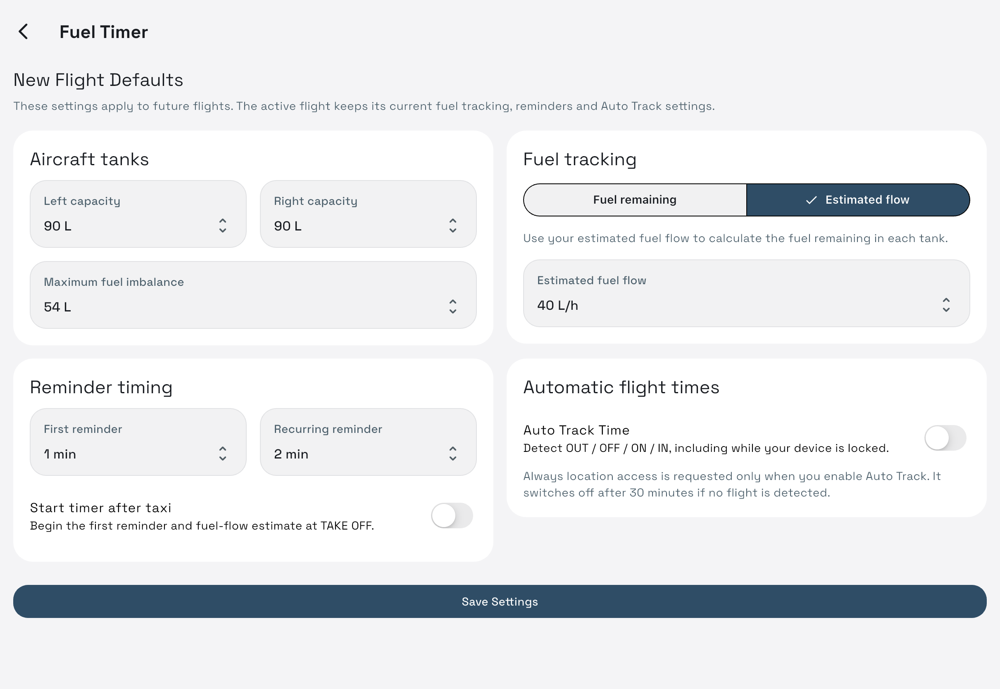

# Fuel Timer

Use it on iPhone, **Fuel Timer only** on iPad Home, or **Fuel Timer** above a flight's notes. The same timer handles all three entry points. Only one timer session can be active.

## Configure once, start quickly

In Fuel Timer settings, set left/right tank capacities, maximum imbalance, tracking mode, reminder intervals, taxi behavior and Auto Track defaults. On iPad these are under **Settings → Fuel Timer**; on iPhone use **Settings**.

Starting a session asks for the **first tank and starting left/right liters**. Levels are prefilled from the last completed flight. Check them before starting. Changing global defaults later affects future sessions; the active timer keeps its configuration.

## The two fuel modes

| Mode | What you enter | What Pitolio calculates |
| --- | --- | --- |
| Fuel remaining | Actual total fuel remaining at a check | Fuel used and observed flow |
| Estimated flow | Estimated liters/hour | Estimated remaining left/right fuel |

Fuel values use liters. The aircraft view shows the active tank, tank levels and imbalance warning against your configured limit. Estimated values are calculations from your entries, not readings from an aircraft sensor.

## Start, take off, land, stop

| Step | Timestamp | Meaning |
| --- | --- | --- |
| START | OUT | Off-block; starts block time |
| TAKE OFF | OFF | Starts flight time |
| LAND | ON | Ends flight time |
| STOP | IN | Ends block time and confirms/saves the log |

In notes, the compact strip highlights the current step, enables the next step and disables later steps. It also shows the fuel-check countdown and left/right liters. Its expand action opens the full timer.

The full timer permits **Stop** any time after **Start**, including before Takeoff. For a taxi-only or aborted flight, expand the timer and use Stop to save that session; Cancel Flight discards it instead.

If **Start timer after taxi** is configured, the first reminder/estimated consumption begins at Takeoff; the configured taxi fuel is deducted from the active tank then. Otherwise fuel timing starts at Start.

**Cancel Flight** discards the current timer session after confirmation; existing notebook notes remain. Stop saves a completed timer flight. Another timer can then start, including on the same notebook flight.

## Fuel checks and tank changes

Tap the selector/tank-change control or respond to a reminder. Confirm the requested remaining fuel or estimated flow, choose **switch** or **stay**, and optionally change the next reminder once. Estimated-flow mode also offers the next flow rate. The fuel log records these actions.

The countdown can become overdue. Notification scheduling errors are shown with Retry. Permission and Focus settings can affect delivery; see [reminder troubleshooting](troubleshooting.md#fuel-reminder-missing).

## Optional Auto Track

Enable **Auto Track Time** in defaults. It uses device location/movement to detect OUT, OFF, ON and IN, including while locked. It needs Location Services and **Always** location permission; permission is requested only when enabling it.

Use the next manual action when a milestone has not been detected. The status banner can disarm Auto Track. If no flight is detected within 30 minutes of arming, it disarms automatically. GPS availability and device placement affect detection.

The app processes movement on the device; it does not save a route track. Notes and manual timing do not need location access.

## Link to a notebook flight

One notebook flight owns a timer across all of its pages. Another flight can open the active owner, but cannot take its timer or receive its automatic times.

You can start either first:

- Create the notebook flight, then start its Fuel Timer.
- Start a timer without notes, then open/create a flight and choose **Use active timer for this flight**. Home can also offer **Add notes** for the unassigned timer.

Attaching preserves its recorded milestones and fuel. A timer already owned by another flight cannot be reassigned. Stop or Cancel releases the active session; the latest run supplies that flight's timer references.

Filled timestamp boxes prompt to clear or keep previous entries. See [page time rules](writing-and-fields.md#times-from-the-fuel-timer).

## Saved timer flights

Open **Flights** on iPhone or **Settings → Saved timer flights** on iPad. Select a record for OUT/OFF/ON/IN, block/flight durations, fuel totals and the event log, including taxi consumption where configured.

Tap a recorded time to correct it. Choose **Zulu** or **Local** in the editor; storage remains UTC. Swipe a saved record left and confirm to delete that timer log. This is separate from notebook books/pages and their Trash.

[Quick start](quick-start.md) · [Writing and times](writing-and-fields.md) · [All help](index.md)
