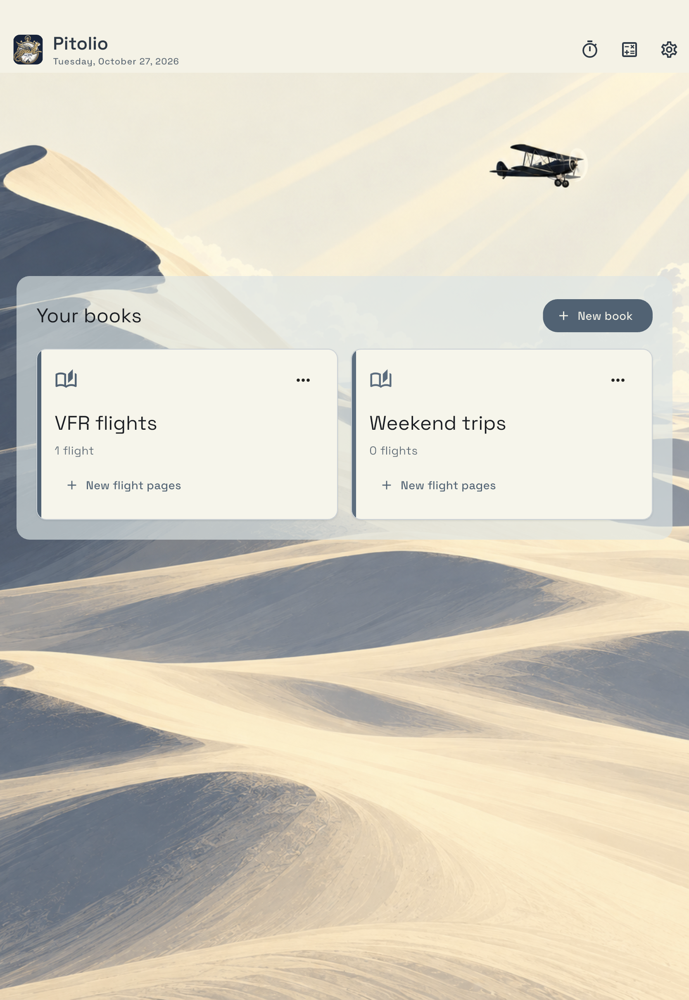

# Pitolio user guide

Pitolio 1.2.0 · Updated 27 October 2026

**iPhone and iPad:** flights, fuel timer, flight history, calculator and their settings. **iPad only:** books, flight pages, notes, Pencil, templates, guided field entry and book PDF/export/backup.

| I want to… | Open |
| --- | --- |
| Get ready for a first flight | [Quick start](quick-start.md) |
| Add, switch, copy, rename or delete a flight/page | [Books and flight pages](books-and-flights.md) |
| Write, type or fill an ATIS quickly | [Writing and field entry](writing-and-fields.md) |
| Choose a template, use a PDF or design a form | [Templates](templates.md) |
| Run fuel checks and record flight times | [Flights and fuel timer](fuel-timer.md) |
| Export pages or keep an editable backup | [Export and backup](export-and-backup.md) |
| Change defaults or calculate durations | [Settings and calculator](settings-and-calculator.md) |
| Fix a problem | [Troubleshooting](troubleshooting.md) |

The guides describe Pitolio 1.2.0. Existing saved pages retain their layouts when templates change. [Screenshot sources](../assets/screenshots/README.md) document the demonstration captures.

[Contact support](https://couillonnade.github.io/pitolio-support/#support) · [Privacy](https://couillonnade.github.io/pitolio-support/privacy-policy.html) · [Home](../README.md)
