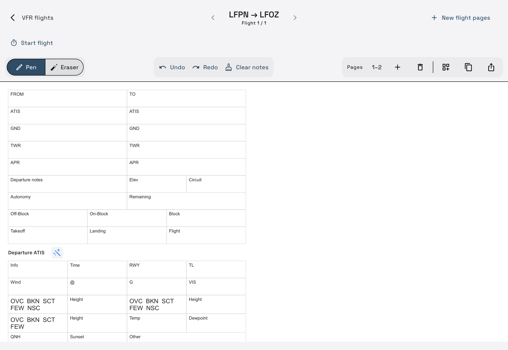
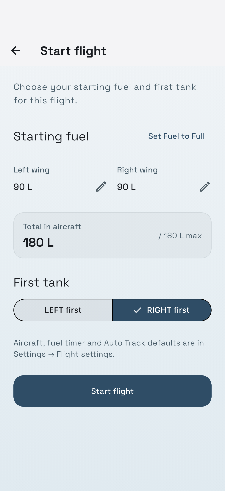

# Quick start

Pitolio 1.2.0 · Updated 27 October 2026

## iPad: your first book and flight pages

1. Tap **New book** on Home. Give it a name and choose one or two page templates. **Flight Notes + Blank paper** provides a form and a scratch page.
2. Tap **New flight pages** on the book. Each flight gets fresh pages from those templates.
3. Write with Apple Pencil, or tap a field with a finger to type. Use one finger to pan and two to zoom.
4. For guided ATIS entry, tap the **wand beside Departure ATIS or Arrival ATIS**. Use Next/Previous or the field tabs.
5. To track a flight, tap **Start flight** above the pages. Choose the first tank and starting left/right liters, then **Start flight**. Record OUT, OFF, ON and IN as the flight progresses; **End & save flight** archives its log.

Notes save automatically. A Home book card opens its newest visible flight’s first page. Tap the centered title for **Flights**, the book’s flight list, or to rename the current flight.

Wide landscape windows show two pages together. Use the page tabs for another page or pair. **+** adds a page up to four. Each OUT/OFF/ON/IN/Block/Flight field can appear once across those pages.

## iPhone: start a flight

1. Complete the welcome setup: tank capacities, tracking mode and fuel reminder defaults.
2. Tap **Start flight**, choose your first tank and starting liters, then **Start flight**.
3. Record **OUT → TAKE OFF → LAND**, then **End & save flight**. Starting a flight and recording OUT are separate actions. Before OUT, selecting a tank only changes the first tank; fuel use and reminders have not begun. Optional Auto Track can detect milestones; manual actions remain available.
4. At a fuel check, confirm the tank and requested fuel reading or estimated flow.
5. Find saved flight logs in **Flight history**.

On iPad, **Start flight** in the Home top bar opens the same flight process without creating pages. You can associate flight pages afterwards.

## Correct a time

Enter OUT/OFF/ON/IN before capture to preserve a manual entry. Edit afterwards in the pages or flight log to update it everywhere. Leave a field empty to use capture. Opening a time and saving it unchanged keeps the recorded value. The time editor lets you choose **Zulu** or **Local** and change the date. Block and Flight are calculated. See [shared flight times](writing-and-fields.md#shared-flight-times).

[Books and flight pages](books-and-flights.md) · [Flights and fuel timer](fuel-timer.md) · [All help](index.md)
