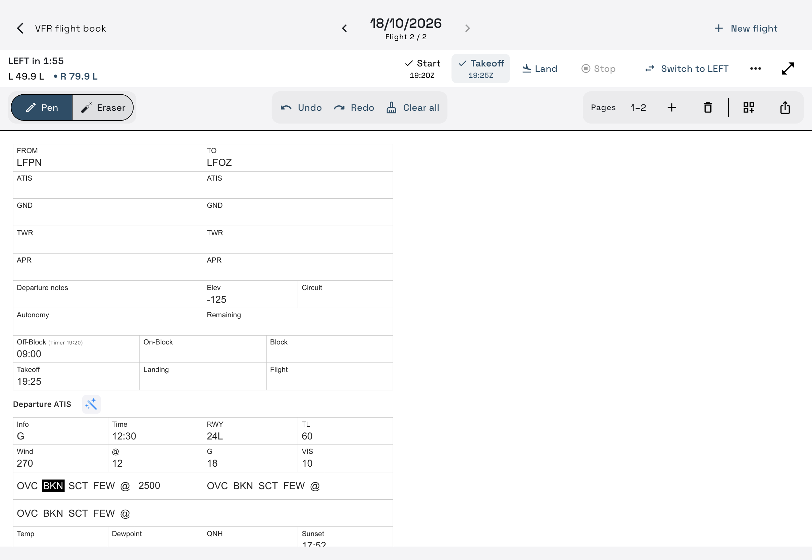

# Quick start

## iPad: your first flight book

1. Tap **New book** on Home. Give it a name and choose one or two page templates. **Flight Notes + Blank paper** is a form plus a scratch page.
2. Tap **New flight** on the book. Each new flight gets a fresh set of those templates.
3. Write with Apple Pencil, or tap a field with your finger to type. Use one finger to pan and two to zoom.
4. For guided ATIS entry, tap the **wand beside Departure ATIS or Arrival ATIS**. Use Next/Previous or the field tabs.
5. If you want fuel tracking, tap **Fuel Timer** above the tools. Choose the first tank and starting left/right liters, then record Start, Takeoff, Land and Stop as the flight progresses.

Notes save automatically. The Home book card opens the newest visible flight on its first page. Tap the centered flight title to choose another flight or rename the current one.

In a wide landscape window, two pages appear together. Use the page tabs for another page/pair. **+** adds a page, up to four in a flight.

## iPhone: Fuel Timer

1. Complete the welcome setup: tank capacities, tracking mode and reminder defaults.
2. Tap **Start New Flight** and choose your first tank and starting liters.
3. Use **START → TAKE OFF → LAND → STOP**. Auto Track can detect these events if enabled; manual actions stay available.
4. At a fuel check, confirm the tank and the requested fuel reading or estimated flow.
5. Stop and confirm final fuel to save the timer log under **Flights**.

On iPad, **Fuel Timer only** in the Home top bar opens the same timer workflow without creating notes.

[Books and flights](books-and-flights.md) · [Fuel Timer details](fuel-timer.md) · [All help](index.md)
