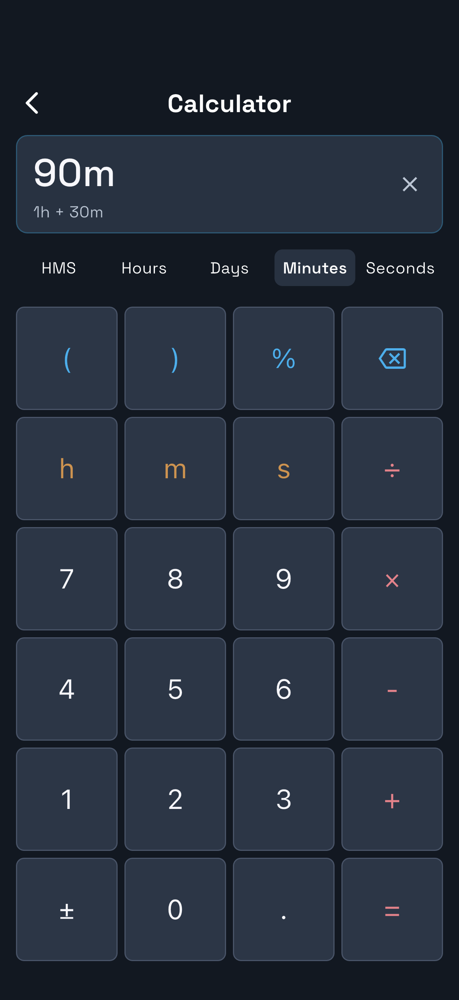

# Settings and calculator

Pitolio 1.2.0 · Updated 27 October 2026

## Settings on iPad

Open the cog on Home.

| Setting | Purpose |
| --- | --- |
| Language | Choose Français or English; changes save immediately |
| Appearance | Follow the device's light/dark appearance throughout flight pages and flight screens |
| Default pages for new books | Choose one/two starting templates; Back saves automatically |
| Templates | Design, import, export, assign and delete reusable forms/PDFs |
| Flight settings | Future-flight tank, flow, reminder, taxi and Auto Track defaults |
| Flight history | Open, correct or delete flight logs and open associated flight pages |
| Restore editable book backup | Import a separate editable copy of an `.apbook` |
| Trash | Restore books, flights or pages; Empty Trash permanently removes trashed content after confirmation |
| About Pitolio & note tips | Opens About & tips: device availability, iPad notes, Flight tips and calculator help |
| Welcome guide | Repeat the introduction |

Book-specific page defaults are in that book's **Book name & templates** action. They do not retroactively change filled flights. Flight settings use **Save Settings**; changing them leaves a running session unchanged.

On iPhone, Home gives direct access to **Flight history**, **Time Calculator**, **Settings** and **About**. **About & tips → On your device** explains which features are available; **Flight tips** applies to both device families. Books and the flight pages reader are iPad-only.

**Settings → Language** is available on both devices. First launch chooses French for a French-language device and English otherwise; your choice is then remembered. Switching language keeps the active flight and saved notes. Existing page labels, custom templates, book names and flight titles retain their original text. New French installations use the **Notes de vol** form.

## Time calculator

Open the calculator from iPad Home's top bar or the iPhone **Time Calculator** card.

- Use regular arithmetic, parentheses and percent.
- Add `h`, `m` or `s` when entering a duration: `1.5h + 22m + 30s`.
- After **=**, swipe the result or tap the format labels to switch between available hours/days/minutes/seconds formats.
- Plain numbers remain numbers; they do not become minutes automatically.
- Backspace removes the last entry character; **C / AC** clears the current entry or calculation.

The expression and result state are stored locally. Calculator use does not alter flight times.

[Templates](templates.md) · [Fuel timer](fuel-timer.md) · [All help](index.md)
