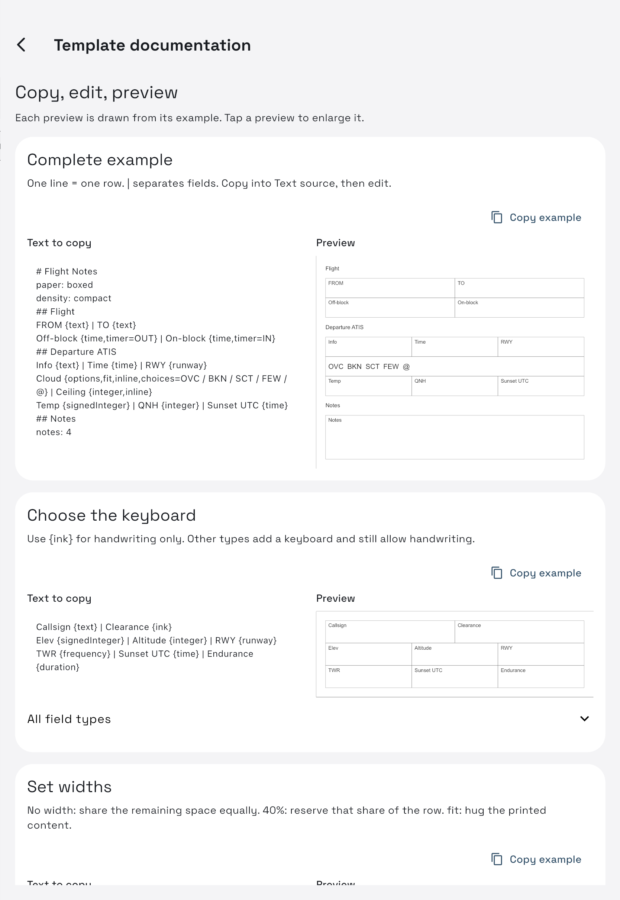

# Templates

**iPad only.**

## Choose a template

**Flight Notes** is the built-in flight form. **Blank paper** gives you a scratch page. Each book chooses one or two starting templates; **+** in a flight adds another page using any available template.

Use **Settings → Templates → template actions → Use in a book** to choose a book/page slot. **Default for new books** changes the app's starting choice. Both affect future pages, not completed notes.

In an open flight, the template/background icon opens **Page template & background**. Select a page, then **Apply page template**. Written pages are protected; add a new page to use a different layout without losing notes.

## Make or import

In **Settings → Templates**:

- **Design template** opens Rows and Text source with a live preview. Add rows/sections/notes/frequencies; move rows up/down or drag them to reorder. Save the template when finished.
- **Import text template** opens a saved `.txt` source; **Export text template** shares it again.
- **Import PDF** uses a PDF page as a background. In its editor, drag rectangles to add typed-field hotspots. Pencil can write elsewhere too.
- **Documentation (?)** opens copyable examples and previews in the app.



Tap a preview in the app to enlarge and zoom it.

## A small form

Paste into **Text source**, then use the preview to check it:

```text
# My flight form
paper: boxed
## Flight
FROM {text} | TO {text}
Elev {signedInteger} | RWY {runway}
Off-block {time,timer=OUT} | On-block {time,timer=IN}
## Arrival ATIS
Info {text} | Time {time} | QNH {integer} | Sunset UTC {time}
Cloud {options,fit,inline,choices=OVC / BKN / SCT / FEW / @} | Ceiling {integer,inline}
notes: 4
```

One line makes a row. `|` separates cells. `##` prints a section title and gives its typed fields a guided-entry wand. `#` is a source comment, not a printed heading.

## Types at a glance

| Type | Keyboard / purpose |
| --- | --- |
| `ink` | Handwriting zone without a keyboard |
| `text` | Uppercase text |
| `integer` | Whole number |
| `signedInteger` | Whole number with optional minus |
| `frequency` | COM frequency with automatic decimal/zeros |
| `time` | 24-hour UTC clock |
| `duration` | Hours:minutes |
| `runway` | 01–36 with optional L/C/R |
| `options` | Named choices, separated with `/` |

`number` remains accepted for older templates; use `integer` or `signedInteger` in new ones. All fields can also be handwritten.

## Width and choices

```text
FROM {text,40%} | TO {text} | Alternate {text}
Runway condition {options,choices=DRY / WET / SNOW COVERED}
```

The first row gives FROM 40%; the other two share what remains. With no width, cells divide equally. `fit` reserves just the printed content's width; do not use `0%` or `fit%`. Percentages plus fitted cells must leave room for flexible cells. Labels wrap automatically.

`inline` hides the printed label and joins a value to preceding options, as in the cloud/ceiling example. The short field name still identifies it in the keyboard. A final `@` is a printed marker, not a selectable cloud type.

## Other useful lines

| Source | Result |
| --- | --- |
| `notes: 6` | Handwriting block, six height units |
| `frequencies: 4` | Four Name/Frequency rows |
| `scratch: 4` | Four frequency rows beside a large clearance area |
| `space: 2` | Gap before the next row/section |
| `paper: boxed` / `dotted` / `blank` | Touching grid borders, dots or plain paper |
| `density: compact` | Shorter rows |
| `size: 624 x 1340` | Logical page width and height |

Counts are 1–30; size limits are width 200–2000 and height 200–4000. The full template must fit one page. Put page-wide settings at the top. Arbitrary `align`, font/color, maximum-length and fixed-row-height properties are not supported; use widths, inline and row order. Labels cannot contain `|`, `{` or `}`; choices cannot contain commas.

For timer values, add `timer=OUT`, `OFF`, `ON` or `IN` to a `time` field; use `timer=BLOCK` or `FLIGHT` with `duration`.

## Preserve existing notes

Editing or deleting a reusable template does not move the ink or remove the background of existing flight pages, including pages in Trash. Deleting it removes it from future choices and changes affected defaults to Blank paper. PDF files are cleaned from local storage only when no saved page/template still references them.

For imported PDFs, **Use original PDF appearance** in the page-background screen keeps their imported colors. Turn it off for night adaptation. This affects the open Reader session, not the original PDF.

[Books](books-and-flights.md) · [Writing](writing-and-fields.md) · [All help](index.md)
