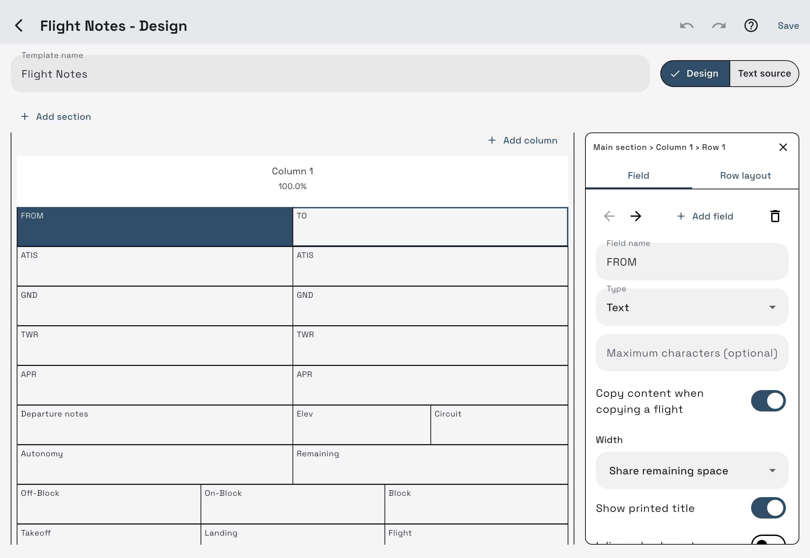
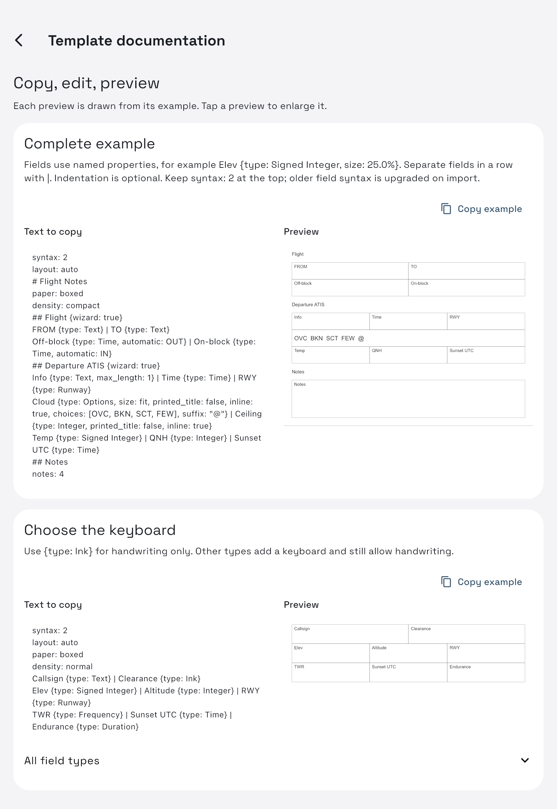

# Templates

Pitolio 1.2.0 · Updated 27 October 2026

**iPad only.** Templates define the layout used when a page is created. Existing pages keep their layout, typed values and ink when a reusable template changes.

## Choose or replace a template

**Flight Notes** is the built-in flight form. **Blank paper** gives you a scratch page. Each book chooses one or two starting templates; **+** in a flight adds another page, up to four.

Use **Settings → Templates → template actions → Use in a book** to choose a book/page slot. **Settings → Default pages for new books** changes the starting choice for new books; Back saves automatically. These choices affect future pages.

On flight pages, the template/background icon opens **Page template & background**. Select a page using the numbered buttons, choose a template from the inline list, then tap **Apply page template**. The page saves before returning to notes. Ink and manual typed notes protect a written page from replacement; add a page or create new flight pages for a different layout. Shared recorded times are reapplied to a replacement page. A failed save keeps the selection available for Retry.

## Design a form

In **Settings → Templates**, choose **Design template** or edit an existing template. The **Design** editor contains sections, columns, rows and fields:

1. Use **Add section** above the template. Add rows inside a column and fields inside a row.
2. Tap a field to open **Field** settings: name, type, choices, width, printed title and **Copy content**.
3. Use **Row layout** for **Repeat** and **Fill column height**. Filling rows share the available height while keeping room for their content.
4. Move or delete fields, rows and columns using their own controls. Deletion asks for confirmation. Drag a column divider to resize its two neighbors; double-tap to divide their combined width equally.
5. Use **Undo / Redo** while editing, then **Save** the reusable template.

The settings panel sits beside the template in wide landscape windows and below it in portrait or narrow windows. Select another field to change its settings. **Text source** edits the same form; invalid source stays available for correction.



Turn **Wizard** on for a section to give its typed and option fields a guided-entry wand. A section called ATIS does not enable a wand by its name alone. **Copy content** is a per-field setting: it carries that field’s typed values and handwriting into **Copy this flight**. Other fields start blank. Copies have their own date and no timer/log ownership.

## Import, export and examples

- **Import text template** opens a `.txt` source. **Export text template** shares it through Files.
- **Import PDF** uses a PDF page as a background. In its editor, drag rectangles to add typed-field hotspots. Pencil can write elsewhere too.
- **Documentation (?)** opens copyable examples and matching previews. Tap a preview to enlarge and zoom it.



## A small form

Paste this current source format into **Text source**, then check the preview:

```text
syntax: 2
# My flight form
layout: auto
paper: boxed
## Flight {wizard: true}
FROM {type: Text, size: 40.0%, copy_content: true} | TO {type: Text}
Elev {type: Signed Integer} | RWY {type: Runway}
OUT {type: Time, automatic: OUT} | IN {type: Time, automatic: IN}
Block {type: Duration, automatic: BLOCK}
## Arrival ATIS {wizard: true}
Info {type: Text, max_length: 1} | Time {type: Time}
Cloud {type: Options, choices: [OVC, BKN, SCT, FEW, NSC]} | Height {type: Integer}
QNH {type: Integer} | Sunset UTC {type: Time}
notes: 4
```

A line makes a row; `|` separates fields. `##` makes a section heading, with `{wizard: true}` enabling its wand. `#` is a source comment, not a printed heading. An explicit `max_length: 1` advances a text field after one character. Other text and numbers use Next.

## Types and widths

| Type | Keyboard / purpose |
| --- | --- |
| `Ink` | Handwriting zone without a keyboard |
| `Options` | Named choices supplied as a list |
| `Text` | Uppercase text |
| `Integer` | Non-negative whole number |
| `Signed Integer` | Whole number with optional minus |
| `Runway` | 01–36 with optional L/C/R |
| `Frequency` | COM frequency with automatic decimal/zeros |
| `Time` | 24-hour clock; ordinary clock fields use UTC |
| `Duration` | Hours:minutes |

Older field spellings and sources are read and upgraded on import. Use the current names for new sources. All fields can also be handwritten.

`size: 40.0%` reserves that share of the entire row. `size: fit` measures printed content; fields without a width share the remaining space. Reservations must leave room for flexible fields. Labels wrap. Zero width is invalid.

`printed_title: false` hides a label on the printed page while keeping its name in the keyboard. `inline: true` joins the value to preceding options and requires a hidden printed title:

```text
Cloud cover {type: Options, size: fit, printed_title: false, choices: [OVC, BKN, SCT, FEW], suffix: "@"} | Ceiling {type: Integer, printed_title: false, inline: true}
```

This is an optional custom layout; the current Flight Notes template prints Height above each cloud height without an @ suffix. Quote source strings containing commas, braces, pipes or reserved words. In the visual designer’s **Choices** input, separate choices with `/`; in source, use a list such as `[DRY, WET, "SNOW COVERED"]`.

## Columns and repeated rows

```text
syntax: 2
layout: auto
columns:
  column {size: 46.0%}:
    row {repeat: 8}:
    Name {type: Text, copy_content: true} | Frequency {type: Frequency, copy_content: true}
  endcolumn
  column {size: 54.0%}:
    row {fill_column_height: true}:
    Clearance {type: Ink}
  endcolumn
endcolumns
```

Column percentages must total 100.0%. Explicit closing markers define the structure, so indentation is optional. Fill column height works on any row, including one in the middle. Repeated instances share that row’s height.

| Source | Result |
| --- | --- |
| `notes: 6` | Handwriting block, six height units |
| `frequencies: 4` | Four Name/Frequency rows |
| `scratch: 4` | Four frequency rows beside clearance notes |
| `space: 2` | Gap before the next row/section |
| `paper: boxed` / `dotted` / `blank` | Grid borders, dots or plain paper |
| `density: compact` | Shorter rows |
| `layout: auto` | Fit the available width and grow with the content |

Put page-wide settings at the top. Counts are 1–30. A template must fit a single page. The designer represents notes, frequencies and scratch areas using ordinary editable rows and columns.

## Shared times and saved pages

Use `automatic: OUT`, `OFF`, `ON` or `IN` with `Time`, and `automatic: BLOCK` or `FLIGHT` with `Duration`. The older `timer=` spelling remains readable. Each binding can appear only once across a flight’s one to four pages, including equivalent aliases. Conflicts identify the existing page, for example “OUT is already on page 1.” This applies to starting defaults, addition, replacement and restoration. Existing duplicate layouts remain readable and share the recorded value. Block and Flight are calculated totals.

Deleting a reusable template removes it from future choices and switches affected defaults to Blank paper. Existing pages, including pages in Trash, keep their layout and PDF backgrounds. Background files are removed only when no saved item still needs them. Built-in source upgrades affect future pages; customized templates keep their changes.

If a flight has a PDF background, **Use original PDF appearance** in the page-background screen keeps its imported colors. Turn it off for night adaptation. This affects the current Reader session and does not rewrite the PDF.

[Books and copying](books-and-flights.md#copy-a-flight) · [Writing](writing-and-fields.md) · [All help](index.md)
