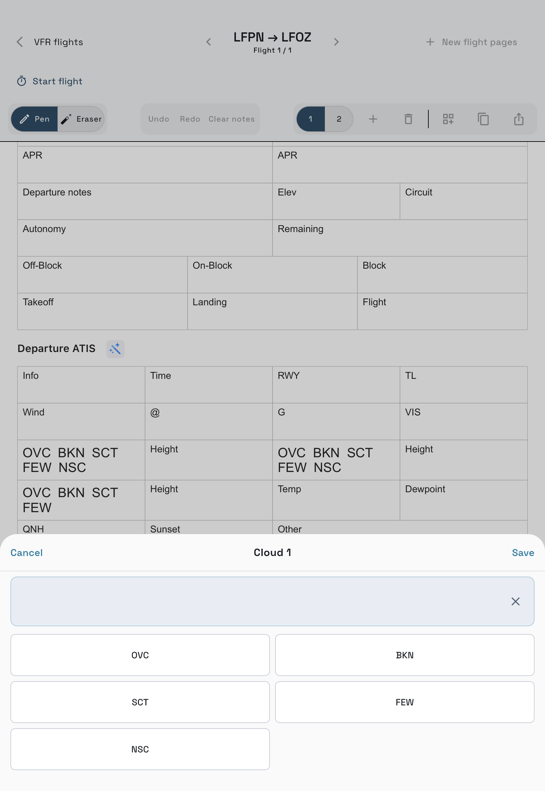
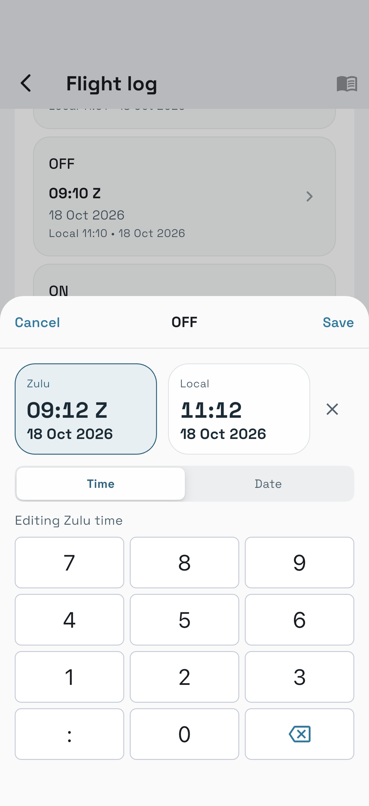

# Writing and field entry

Pitolio 1.2.0 · Updated 27 October 2026

**iPad only.**

## Pencil, fingers and editing

| Gesture / tool | Result |
| --- | --- |
| Apple Pencil | Write on the page; tap a printed option to select it |
| One-finger drag | Pan, including when starting over a field |
| Two-finger pinch | Zoom |
| Finger tap on a field | Open its keyboard |
| Pen / Eraser | Highlight shows the selected tool; Eraser removes ink only |
| Undo / Redo | Undo or repeat recent page edits during this open flight session |
| Clear notes | After confirmation, clear this page’s ink, typed notes and choices; recorded flight times remain |

Clear notes leaves the active flight running and can be undone as one action. Undo and Redo do not change recorded flight times. Undo history ends when you close the flight pages. For an ordinary typed note, open its keyboard and use **Clear**. To correct a recorded flight time, enter its replacement.

Pencil touches are excluded from the page's pan/zoom gestures. Physical Pencil latency and palm behavior depend on the device; [report a Pencil problem](https://couillonnade.github.io/pitolio-support/#support) with its model and the gestures involved.

## Type a field

Text starts uppercase. The first character you type replaces the selected value. Opening a field, moving between fields or saving it unchanged keeps its saved content. The keyboard matches the field:

| Field | Enter | Saved value |
| --- | --- | --- |
| Frequency | `11945`, `123.5` or `123` | `119.450`, `123.500` or `123.000` |
| Clock / Sunset | `1230` | `12:30` UTC |
| Runway | `07L`, `25R`, `12` or `05C` | Runway 01–36, optionally L/C/R |
| Signed integer | `-125` | Negative elevation, circuit altitude or temperature |
| Options | Tap a choice | Choice highlighted on the page |

Frequency entry accepts the range **118.000–136.975 MHz**. Missing fractional zeros are added when saved. It does not tune a radio. Integer keyboards have no decimal key. Sunset is entered manually in UTC.

Generated labels and lines stay sharp while zooming. A scanned PDF can only show the detail present in its original image.

## Fill an ATIS in one keyboard

Tap the **wand beside the section title**. The scrollable field tabs show your place; **Previous / Next** moves between fields and selects the existing value for replacement. Some fixed-length fields advance when complete, including the ATIS information letter and clock. Underscores show the expected input length.

The current Flight Notes form offers **OVC / BKN / SCT / FEW / NSC** for the first two cloud fields, and **OVC / BKN / SCT / FEW** for the third. A cloud choice advances to its adjoining **Height**. Empty fields advance in source order; later cloud fields are not skipped. Height labels print above the values, without an @ suffix. Older saved pages keep their original geometry. You can select a printed cloud choice with the keyboard or Pencil. Long option lists scroll horizontally.

Moving to another field saves valid changes. **Save**, **Close** and Back save the current valid entry before closing. Invalid input or a failed save keeps the panel open for correction or retry. **Discard** abandons the current unsaved edit; fields already saved remain. A section offers guided entry only when its template has **Wizard** enabled; its name alone does not enable it.

Guided entry is reusable for template sections; frequency/scratch tables use individual field taps instead.

## Shared flight times

OUT, OFF, ON and IN have one recorded value shared by the flight, its flight log and all associated flight pages:

| What you do | What happens |
| --- | --- |
| Type before capture records a time | Your manual entry is kept |
| Edit afterwards on flight pages or in the flight log | The change appears everywhere |
| Leave a time empty | The flight captures it |

Tap a time box with a finger to use its keypad; no Pencil is needed. The time editor shows **Zulu** and **Local** cards with complete dates. Select the timezone you want to enter, then **Time** for the keypad or **Date** for the calendar. Tap the calendar’s month/year heading to choose a year. Changing the date keeps that timezone’s clock time and updates both previews. **Save** commits the change; **Cancel** discards it. Unchanged Save preserves the current recording, even if an automatic capture happened while the editor was open. Local times that do not exist during a daylight-saving change are rejected; repeated local times offer their UTC offsets. Times must follow OUT ≤ OFF ≤ ON ≤ IN order. These are recorded events: entering IN stops timing. **End & save flight** remains available to archive an unsaved flight.

Page and log times display the nearest whole minute (30 seconds rounds up). Block is displayed IN minus OUT; Flight is displayed ON minus OFF. Live clocks and fuel calculations keep the original timestamp precision. Full dates handle midnight and multi-day flights. These totals do nothing when tapped. Handwriting is preserved as an annotation and is not interpreted as a recorded time. PDF export uses the same recorded values as the pages and log, without alternate timer references.

The first flight keeps times entered before capture. Starting another flight with existing entries asks **Start another flight?** Choose:

- **Clear and Fly**: clear the previous entries and handwriting inside OUT, OFF, ON, IN, Block and Flight boxes, then start the flight.
- **Cancel**: change nothing.

ATIS, Sunset and handwriting outside those boxes remain. Cancelling a flight or deleting its log also keeps its page entries; it does not recreate a deleted log.

Existing flights use the same rules. When older page entries differ from an associated log, the log supplies the shared recorded times while handwriting is preserved. Pages without an associated log retain their entries.

[Flights and fuel timer](fuel-timer.md) · [Templates](templates.md) · [All help](index.md)
