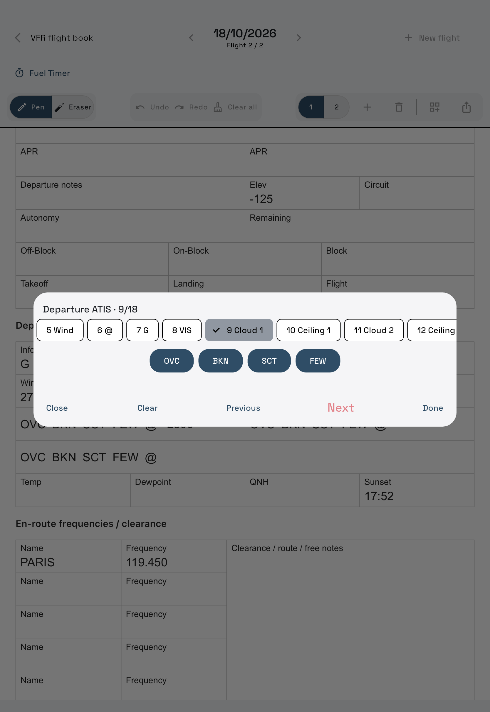

# Writing and field entry

**iPad only.**

## Pencil, fingers and editing

| Gesture / tool | Result |
| --- | --- |
| Apple Pencil | Write on the page; tap a printed option to select it |
| One-finger drag | Pan, including when starting over a field |
| Two-finger pinch | Zoom |
| Finger tap on a field | Open its keyboard |
| Pen / Eraser | Highlight shows the selected tool; Eraser removes ink only |
| Undo / Redo | Undo or repeat recent page edits during this open flight session |
| Clear all | After confirmation, clear this page's ink, typed values and choices |

Clear all leaves the Fuel Timer running and can be undone as one action. Undo history ends when you close the flight. To remove a typed value alone, open its keyboard and use **Clear**.

Pencil touches are excluded from the page's pan/zoom gestures. Physical Pencil latency and palm behavior depend on the device; [report a Pencil problem](../SUPPORT.md) with its model and the gestures involved.

## Type a field

Text starts uppercase. The keyboard matches the field:

| Field | Enter | Saved value |
| --- | --- | --- |
| Frequency | `11945`, `123.5` or `123` | `119.450`, `123.500` or `123.000` |
| Clock / Sunset | `1230` | `12:30` UTC |
| Runway | `07L`, `25R`, `12` or `05C` | Runway 01–36, optionally L/C/R |
| Signed integer | `-125` | Negative elevation, circuit altitude or temperature |
| Options | Tap a choice | Choice highlighted on the page |

Frequency entry accepts the range **118.000–136.975 MHz**. Missing fractional zeros are added when saved. It does not tune a radio. Integer keyboards have no decimal key. Sunset is entered manually in UTC.

Generated labels and lines stay sharp while zooming. A scanned PDF can only show the detail present in its original image.

## Fill an ATIS in one keyboard

Tap the **wand beside the section title**. The scrollable field tabs show your place; **Previous / Next** moves between fields and selects the existing value for replacement. Some fixed-length fields advance when complete, including the ATIS information letter and clock. Underscores show the expected input length.

Cloud fields display **OVC / BKN / SCT / FEW** choices, then a ceiling altitude after **@**. You can select the cloud type with the keyboard or Pencil. In guided entry, Next on an empty second cloud choice skips to Temperature. Temp, Dewpoint, QNH and Sunset follow in order. Long option lists scroll horizontally in the keyboard.

Guided entry is reusable for template sections; frequency/scratch tables use individual field taps instead.

## Times from the Fuel Timer

Automatic OUT/OFF/ON/IN and Block/Flight values fill only the owning flight's pages. Manual typed values take precedence. If they differ, a smaller **(Timer 16:40)** reference appears; this also appears in PDF export.

Page totals use valid typed endpoints, including flights crossing midnight. Handwriting is preserved but is not read as a number, so a handwritten or deliberately cleared endpoint leaves that calculated total unknown. Open a field and tap **Use timer…**, then save, to accept the suggested value explicitly. Cancelling leaves the existing note untouched.

On a timer restart, **Clear time fields?** offers:

- **Yes, clear times**: clear typed values and handwriting inside the six timer-bound boxes across the flight's current pages.
- **No, keep times**: retain them as manual entries with new timer references.
- **Cancel**: leave both notes and timer setup unchanged.

ATIS, Sunset and ink outside those boxes remain untouched. These page edits do not rewrite the Fuel Timer's recorded milestones or fuel history.

[Fuel Timer](fuel-timer.md) · [Templates](templates.md) · [All help](index.md)
